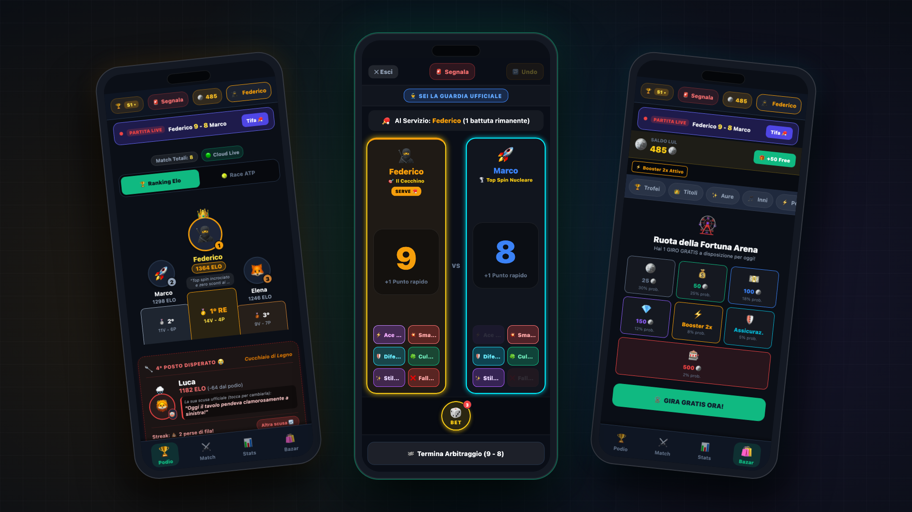
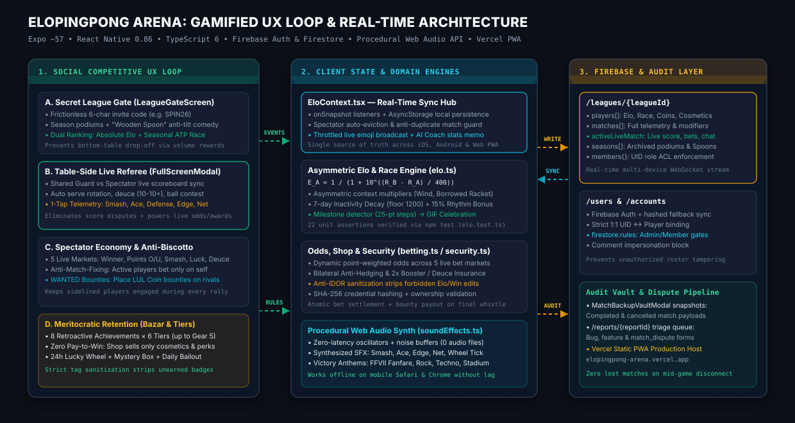
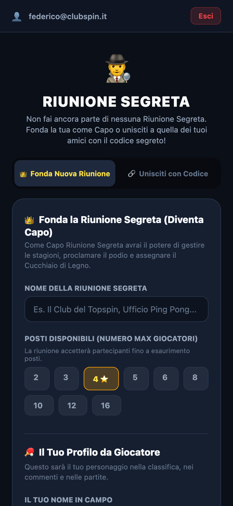
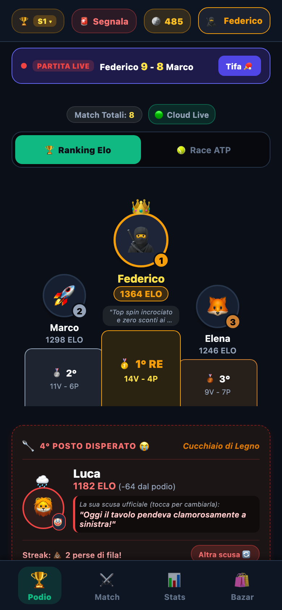
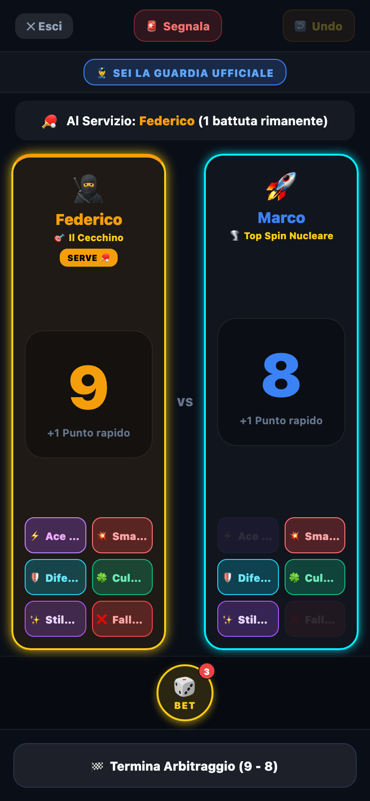
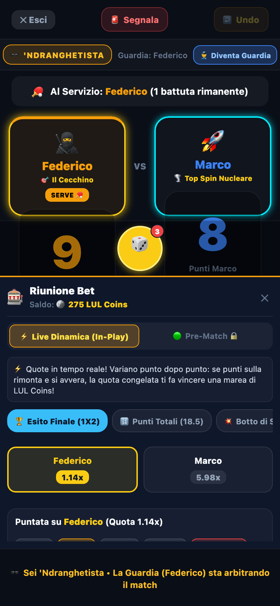
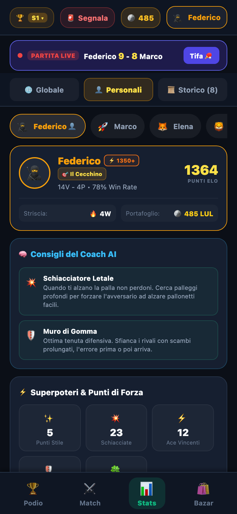
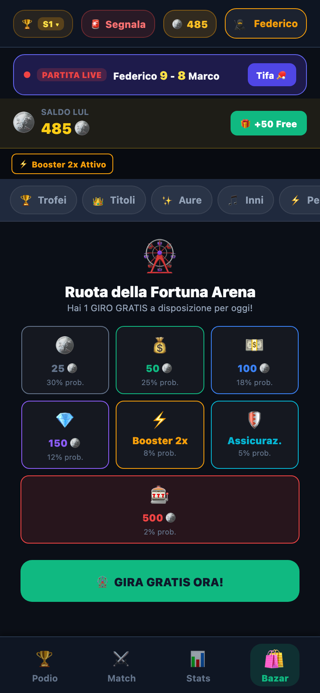
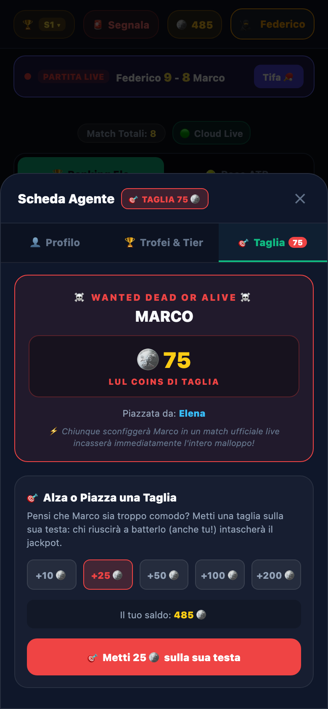

<div align="center">

# 🏓 EloPingPong Arena

**Real-Time Competitive Table Tennis League, Live Referee & Gamified Social Arena**

[](https://elopingpong-arena.vercel.app)
[](https://expo.dev)
[](https://reactnative.dev)
[](https://www.typescriptlang.org)
[](https://firebase.google.com)

*Cross-platform iOS, Android, and Mobile-First Web PWA built with React Native, Expo, TypeScript, Firebase Firestore, and a zero-latency procedural Web Audio API synthesizer.*

> **Note:** The in-app UI copy, tactical coach tips, and comedic league culture are written in **Italian**.

<br />



</div>

---

## 🎯 Product Vision & UX Design Problem

Informal office and club ping pong leagues routinely collapse due to **social competitive friction**:

1. **Score & Serve Disputes:** Without a shared table-side scoreboard, players argue over serve rotation, deuce calls, or forgotten match outcomes.
2. **Bottom-of-Table Churn ("Tilt"):** Players who fall behind in an Elo ladder stop challenging top seeds to protect their rating, or lose motivation completely.
3. **Unfair Context:** A casual match played in wind, poor lighting, or with a borrowed paddle is rarely comparable to a serious derby.
4. **Idle Spectators:** Players waiting for their turn at the table disengage while two others play.

**EloPingPong Arena (`v3.0.0`)** treats table-side UX and behavioral game design as first-class engineering problems:

| UX Friction | EloPingPong Design Solution | Implementation |
| :--- | :--- | :--- |
| **Table-Side Disputes** | Shared **Guard vs. Spectator** full-screen live referee with automatic serve rotation, deuce rules (`10-10+`), undo safety, and an immutable Match Backup Vault. | [`FullScreenLiveMatchModal.tsx`](src/components/FullScreenLiveMatchModal.tsx), [`MatchBackupVaultModal.tsx`](src/components/MatchBackupVaultModal.tsx) |
| **Bottom-Table Drop-off** | Dual **Elo + Seasonal ATP Race** rankings (rewarding match volume alongside skill), **7-day Inactivity Decay** (floor `1200`), and self-deprecating **Wooden Spoon** comedy cards. | [`elo.ts`](src/core/elo.ts), [`SadLoserBox.tsx`](src/components/SadLoserBox.tsx) |
| **Flat Skill Ratings** | **Asymmetric Contextual Elo** combining environmental (`wind`, `dark`, `derby`, `beer`) and personal (`borrowed_racket`, `injured`) multipliers + `+15%` hot-rhythm bonus. | [`constants.ts`](src/core/constants.ts), [`elo.ts`](src/core/elo.ts) |
| **Idle Spectators** | **5-Market Live Betting** (*LUL Coins*) with point-by-point **Dynamic Programming odds**, floating emoji reactions, live commentary, and **WANTED Bounties** placed on rivals. | [`betting.ts`](src/core/betting.ts), [`PlayerProfileModal.tsx`](src/components/PlayerProfileModal.tsx) |
| **Pay-to-Win Risk** | **Strict Meritocratic Economy**: Bazar cosmetics (*Neon/24K Gold Auras*, procedural *Victory Anthems*, *24h Lucky Wheel*) and **6-Tier Achievements** never alter Elo math. | [`shop.ts`](src/core/shop.ts), [`achievements.ts`](src/core/achievements.ts) |

---

## 🏗️ UX Loop & System Architecture

<div align="center">
  
</div>

---

## 📱 Visual Walkthrough

### 1. Secret League Onboarding, Podium & Table-Side Live Referee

<table>
  <tr>
    <td align="center" width="33%">
      
      <br /><strong>Secret League Gate</strong><br />
      <sub>6-character invite code (<code>SPIN26</code>), player avatar/color builder, and admin season controls (<code>LeagueGateScreen</code>).</sub>
    </td>
    <td align="center" width="33%">
      
      <br /><strong>Podium, Elo &amp; ATP Race</strong><br />
      <sub>Live spectator ticker, Top-3 animated podium, equipped auras, and the interactive 4th-place <em>Wooden Spoon</em> excuse box.</sub>
    </td>
    <td align="center" width="33%">
      
      <br /><strong>Table-Side Live Referee</strong><br />
      <sub>One-handed scoreboard with serve tracking and 1-tap telemetry (<em>Ace, Smash, Defense, Edge/Net, Style, Fault</em>).</sub>
    </td>
  </tr>
</table>

### 2. Multi-Market Betting, AI Tactical Coach, Meritocratic Bazar & Bounties

<table>
  <tr>
    <td align="center" width="25%">
      
      <br /><strong>Live Multi-Market Bet</strong><br />
      <sub>Real-time odds across 5 markets (Winner, Total Points, Smashes, Luck Factor, Deuce) with Anti-Biscotto guardrails.</sub>
    </td>
    <td align="center" width="25%">
      
      <br /><strong>Analytics &amp; AI Coach</strong><br />
      <sub>Rule-based tactical coaching derived from match telemetry, superpower counters, and head-to-head rivalries.</sub>
    </td>
    <td align="center" width="25%">
      
      <br /><strong>Bazar &amp; Lucky Wheel</strong><br />
      <sub>6-tab compact economy featuring neon card auras, procedural victory anthems, mystery boxes, and a 24h free spin.</sub>
    </td>
    <td align="center" width="25%">
      
      <br /><strong>WANTED Bounty &amp; Tiers</strong><br />
      <sub>LUL Coin bounties on rivals (paid out to whoever beats them live) alongside 6-tier retroactive career achievements.</sub>
    </td>
  </tr>
</table>

---

## ⚙️ Core Engineering & Mathematical Systems

### 1. Asymmetric Contextual Elo & ATP Seasonal Race ([`src/core/elo.ts`](src/core/elo.ts))
- Standard logistic expected win probability:
  $$E_A = \frac{1}{1 + 10^{(R_B - R_A)/400}}$$
- Asymmetric match multipliers compute `winnerDelta` and `loserDelta` independently from environmental conditions (`wind`, `dark`, `derby`, `beer`) and individual handicaps (`borrowed_racket`, `injured`), scaled by a `+15%` **Rhythm Bonus** when a player logs $\ge 3$ matches within 5 days.
- **Inactivity Decay:** Ratings above `1200` decay by `5` Elo per week after a `7`-day grace period (clamped at `1200`) to prevent rating camping.
- **ATP Race Points:** Parallel seasonal points award `50` pts for sweeps, `40` pts for tight wins, `15` pts for close losses, and `5–10` pts even for friendly/participation games so every match moves the seasonal table.

### 2. Backward-Induction Dynamic Programming Odds & Anti-Biscotto ([`src/core/betting.ts`](src/core/betting.ts))
- Pre-match wagering closes automatically once the total combined score reaches `6` points (`PRE_MATCH_BET_CUTOFF`).
- In-play odds (`calculateLiveDynamicOdds`) compute exact point-by-point win probabilities via **Backward Induction Dynamic Programming** over the state table `dp[score1][score2]` up to `targetPoints` (`11` or `21`), anchored by the closed-form deuce geometric series:
  $$P_{\text{deuce}} = \frac{p^2}{p^2 + (1-p)^2}, \quad p = \text{clamp}_{[0.20, 0.80]}\!\left(\frac{1}{1 + 10^{(R_2 - R_1)/400}}\right)$$
- **5 Live Markets:** `match_winner`, `total_points` (`O/U 18.5` or `38.5`), `total_smashes` (`O/U 2.5`), `luck_points` (edges + nets `O/U 1.5`), and `deuce_happens`.
- **Anti-Match-Fixing ("Anti-Biscotto") & Anti-Hedging:** Active players on the table are programmatically restricted to betting strictly on their own victory; opposing bilateral hedges trigger automatic stake cancellation/refunds before settlement.

### 3. Zero-Latency Procedural Web Audio Synthesizer ([`src/utils/soundEffects.ts`](src/utils/soundEffects.ts))
- Built entirely on the browser `AudioContext` (oscillators, frequency envelopes, noise buffers, waveshaper distortion) with **zero external MP3/WAV downloads** (`0 KB` asset overhead, instant playback on mobile Safari & Chrome).
- Synthesizes tactile table tennis SFX (`playPaddleHit`, `playSmashSound`, `playAceSound`, `playEdgeSound`, `playNetSound`, `playWheelTick`) and multi-note celebratory victory anthems equippable in the Bazar (`FFVII Victory Fanfare`, `Heavy Rock Riff`, `Cyber Rave Drop`, `Stadium Cheer`).

### 4. Real-Time Cloud Sync, Anti-IDOR & Audit Vault ([`src/context/EloContext.tsx`](src/context/EloContext.tsx), [`src/core/security.ts`](src/core/security.ts), [`firestore.rules`](firestore.rules))
- **Live Sync & Spectator Eviction:** Firestore `onSnapshot` listeners synchronize scores, floating emoji reactions, and live bets across devices; if the Guard closes or cancels a live match, connected spectator clients are evicted immediately to prevent stale state mutations.
- **Security & Integrity:** `sanitizePlayerUpdates()` strips protected stats (`elo`, `wins`, `losses`, `id`) from profile update payloads (Anti-IDOR), `sanitizePlayerTags()` enforces strict meritocratic badge ownership, and `MatchBackupVaultModal` stores immutable snapshots of both completed and cancelled live matches.

---

## 📁 Project Structure

```text
EloPingPong/
├── App.tsx                          # Navigation shell, top status bar, live banner & modal orchestration
├── firestore.rules                  # Firestore ACL rules for leagues, users, accounts & reports
├── src/
│   ├── context/EloContext.tsx       # Real-time Firestore state hub, optimistic updates & spectator sync
│   ├── core/
│   │   ├── elo.ts                   # Asymmetric Elo, ATP Race, decay, rhythm bonus & H2H calculations
│   │   ├── betting.ts               # Backward-induction DP live odds, 5 markets & anti-biscotto rules
│   │   ├── achievements.ts          # 8 retroactive achievements × 6 tiers (Legno -> Gear 5)
│   │   ├── trophies.ts              # Meritocratic special trophies aggregated from live match stats
│   │   ├── shop.ts                  # Bazar catalog, neon/gold borders, mystery box & lucky wheel
│   │   ├── security.ts              # SHA-256 hashing, Anti-IDOR sanitization & ownership guards
│   │   ├── firebaseService.ts       # Firestore CRUD, league codes, backup vault & reports
│   │   └── __tests__/elo.test.ts    # 22 unit assertions covering Elo, odds, shop & security
│   ├── screens/                     # LeagueGate, Auth, Leaderboard, NewMatch, Stats, Shop, Profiles
│   ├── components/                  # FullScreenLiveMatchModal, Podium, PlayerProfileModal, Vault, etc.
│   └── utils/soundEffects.ts        # Procedural Web Audio API SFX & victory anthem synthesizer
└── docs/media/                      # App screenshots, composite hero banner & SVG architecture diagram
```

---

## 🚀 Getting Started & Verification

### Prerequisites
- Node.js `>= 20` and npm
- Expo CLI (`npx expo`)

### Install & Run Locally
```bash
git clone https://github.com/federicocolombo12/EloPingPong.git
cd EloPingPong
npm install

# Run Web PWA locally
npm run web

# Or launch via Expo Go (iOS / Android)
npm start
```

### Run Automated Tests & Typecheck
```bash
# Compiles core modules and executes all 22 unit test assertions
npm test

# Strict TypeScript verification
npm run check
```

### Production Web Export & Deployment
```bash
npm run deploy
```

---

## 📄 License

Distributed under the MIT License. See [`LICENSE`](LICENSE) for details.
